# Quarry Mod

A simple quarry for Minecraft 26.3 (Fabric), inspired by Simple Quarries Plus.

## Features

- Mines an area centered on the quarry (15x15 by default, larger with area upgrades), layer by layer, starting from the layer below it and going down to the bottom of the world
- Mines in a fixed grid order starting at the back-left corner (relative to the front of the quarry)
- Mining speed depends on the inserted pickaxe (10x slower than a player mining stone, e.g. about 3 seconds per block with a diamond pickaxe). All blocks take the same time.
- Skips air, liquids, a hopper directly below the quarry, and blocks that are unbreakable in vanilla like bedrock (bedrock can be mined with Mine (Almost) Everything, see Compatibility)
- Liquid handling: before each layer, the quarry scans the layer and the ring just outside the mining area. Water and lava are replaced with filler blocks (tag `quarrymod:filler_blocks`: cobblestone, cobbled deepslate, stone, deepslate, dirt, netherrack, granite, diorite, andesite, tuff), and waterlogged blocks are drained. Each fill takes as long as mining one block (no fuel cost, no pickaxe wear). Blocks that always contain water (kelp, seagrass, bubble columns, also from other mods) are replaced without drops.
- Filler storage: a separate internal store for up to 4608 filler blocks (mixed types are fine). Mined filler blocks go here first, before the filter (so they are kept even if they are on the blacklist); the rest goes through the filter and into normal storage as usual. You can also fill it from the filler slot in the GUI (shift-click works) or with a hopper on the right side. Hover over the filler slot to see how many it holds. Fills use the filler storage first, then filler blocks in normal storage. Hoppers cannot pull from it, and when the quarry is broken, the filler storage stays inside the quarry item (like a shulker box) and comes back when you place it again.
- Builds a wall around the area: the ring just outside the mining area is filled too and never mined, so lakes and oceans stay out
- Stops with a blue light when it runs out of filler blocks, and continues automatically when more are added
- Mined items go into internal storage; when storage is full, items are ejected on top (works well with water collection systems)
- Container contents (e.g. chests) drop on the ground like in vanilla
- Remembers its progress when the chunk unloads or the world is reloaded
- Redstone control: a redstone signal pauses it
- Status light on the front: green = running, red = paused, blue = needs filler blocks, off = finished
- Needs both a pickaxe and fuel to work
- Uses the pickaxe you insert: tool speed, Efficiency, Silk Touch, Fortune and Unbreaking work like vanilla, and the pickaxe takes durability damage
- Runs on furnace fuel: one smelt in a furnace = 12 blocks (coal = 96, lava bucket = 1200); empty buckets go to storage
- 24-slot internal storage; overflow is ejected on top
- Hopper support (left/right as seen when facing the front of the quarry): pickaxes from the back, fuel from the left, filler blocks from the right, and everything in storage can be pulled from below
- Item filter (whitelist / blacklist / disabled) that works on the drops; filtered-out items are destroyed. Silk Touch drops are filtered as what they actually drop (e.g. stone, not cobblestone).
- Speed upgrades I–IV: reduce the slowdown factor step by step (10 → 7 → 5 → 3 → 2). Speed V always mines 1 block per tick (instant mining), regardless of pickaxe and enchantments. Fuel use does not change: the same amount of fuel per block mined.
- Area upgrades I–V: 25x25, 35x35, 45x45, 55x55 and 65x65. A new size takes effect from the next layer.
- Upgrade recipes: the previous tier in the center with 4 materials around it in a plus shape (iron, gold, emerald, diamond, netherite). Tier I uses a redstone block (speed) or an ender pearl (area) in the center.

### Quarry Recipe

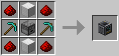

### Upgrades Recipes

| Tier | Area Upgrades                                 | Speed Upgrades                                  |
|------|-----------------------------------------------|-------------------------------------------------|
| I    | 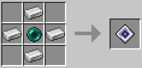     | 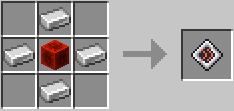     |
| II   | 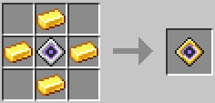   | 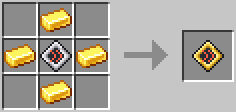   |
| III  | 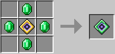 | 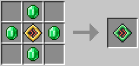 |
| IV   | 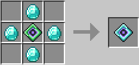   | 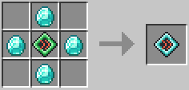   |
| V    | 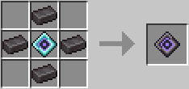     | 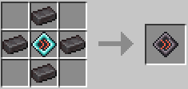     |

## Compatibility

- **Mine (Almost) Everything** (optional, requires 1.1.0 or newer): with this mod installed, the quarry follows the same rules as a player. It can mine bedrock with a netherite pickaxe, get reinforced deepslate with a netherite pickaxe, and get budding amethyst and spawners (which keep their mob type) with Silk Touch on an iron pickaxe or better. It also follows the world's `/mae` settings: when a setting is off, that block works like vanilla (bedrock is skipped; reinforced deepslate, budding amethyst and spawners are mined but drop nothing), and bedrock on the bottom layer of the Overworld (y = -64) is only mined when `overworld_bottom` is on. In the Nether, bedrock on the bottom layer (y = 0) is only mined when `nether_bottom` is on, and on the top layer of the roof (y = 127) only when `nether_roof` is on (these three settings are in Mine (Almost) Everything 1.2.0 and newer; older versions have only `bottom_layer` for the Overworld). Careful: mining a bottom layer can open a hole into the void.
- With Mine (Almost) Everything 1.4.0 or newer (which has `canHarvestWith`), the quarry also follows its harvest rules for blocks a pickaxe normally can't harvest, like cobweb: if Mine (Almost) Everything lets the pickaxe harvest the block, the quarry gets the drops from the block's loot table with the pickaxe as the tool. With older versions, only the vanilla tool check is used.
- Without Mine (Almost) Everything, the quarry works like vanilla: bedrock is skipped, and reinforced deepslate, budding amethyst and spawners are mined but drop nothing.

## Requirements

- Minecraft 26.3
- Fabric Loader
- Fabric API

## License

This mod is licensed under the [MIT License](LICENSE).

## Credits

This mod is heavily inspired by [Simple Quarries Plus](https://modrinth.com/mod/simple-quarries-plus). All code and textures in this mod were made from scratch.
